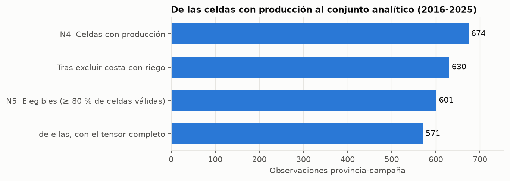
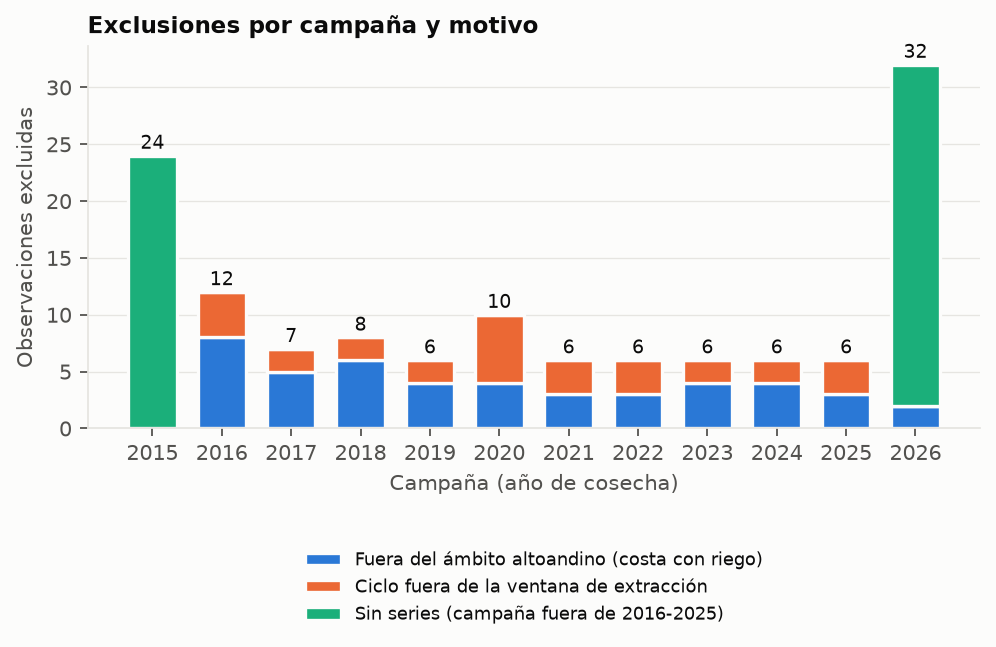
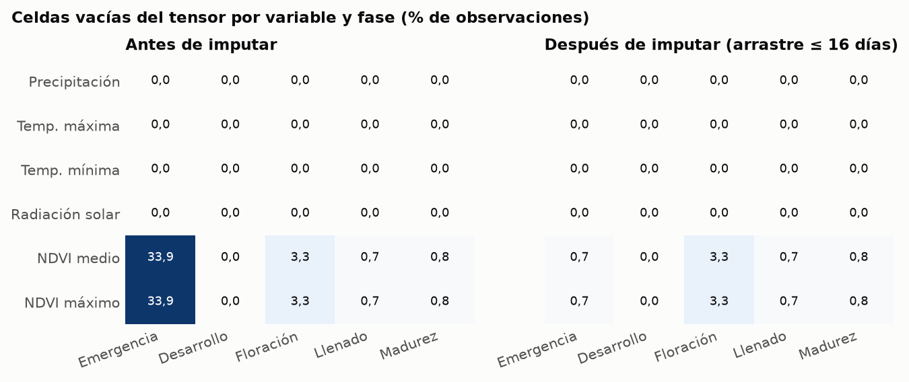
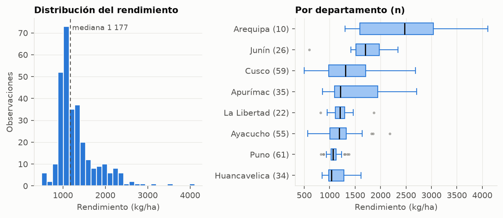
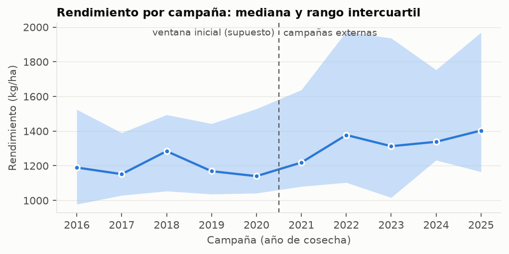
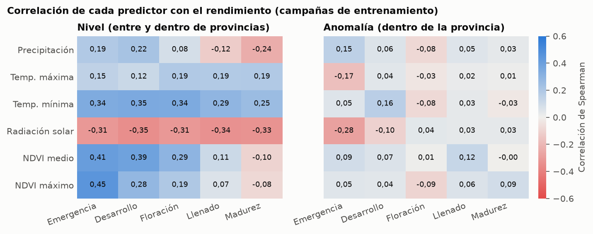

# E3 · Informe de depuración y análisis exploratorio

**Fase CRISP-ML(Q):** F2 · Preparación de datos (actividades 3-5 del cronograma) · **Entregable:** E3
**Proyecto:** Modelo CNN-1D interpretable con SHAP para predecir el rendimiento de quinua en la sierra peruana
**Generado:** 2026-10-10 · **Commit:** `5a250f7` · **Estado del conjunto:** `exploratorio = true` (no válido aún para la evaluación definitiva)

> Este informe se regenera con `python scripts/build_e3_report.py`; ninguna cifra se transcribe a mano.
> Las relaciones predictor–rendimiento y la distribución del objetivo usan **solo las campañas de entrenamiento
> 2016–2020**, para que el análisis exploratorio no oriente decisiones con las campañas externas (sección 4.12.2).

## 1. Resumen

- El conjunto analítico tiene **601 observaciones provincia-campaña** (66 provincias, 2016–2025). El **tensor completo (N5) es de 571** (95 %) tras una imputación limitada de NDVI sin fuga.
- El clima (CHIRPS, ERA5-Land) está **100 % completo**; el NDVI enmascarado tiene 12,7 % de filas sin valor: el 69 % corresponde a 7 provincias costeras o de selva que la máscara de altitud deja sin píxeles por diseño, y el resto son huecos puntuales de calidad (nubes).
- Se detectaron y corrigieron **tres defectos de calidad** durante la preparación (sección 4.3); uno habría invalidado las variables climáticas.
- **90 % de la varianza del rendimiento** (entrenamiento) es **entre provincias** y el resto, dentro de ellas: la línea base provincial (B2) captura buena parte de la señal y el valor añadido de los modelos está en la variación interanual.
- La potencia es limitada: con una ventana inicial de 5 campañas quedan **5 campañas externas**.
- Hay **cinco decisiones provisionales** que requieren al asesor (sección 7).

## 2. Fuentes y trazabilidad

| Artefacto | Ruta | sha256 (16 primeros) |
|---|---|---|
| Series crudas GEE | data/raw/gee_series_crudo.parquet | 6e7a991a53c8eba2… |
| Tensores V×T | data/processed/tensores.npz | 3a44df550568e9af… |
| Observaciones | data/processed/observaciones.parquet | f3b787f3b91eaf6e… |

Fuentes: SIEA-MIDAGRI (rendimiento y siembra, `SISAGRI.xlsx`); CHIRPS v2.0 (precipitación); ERA5-Land DAILY_AGGR (temperaturas y radiación); MODIS MOD13Q1 V061 (NDVI, 250 m) sobre la máscara agrícola (ESA WorldCover v200 2021 + SRTM). Procedencia por variable, hashes y el incidente de extracción: `data/manifest/gee_series_climaticas_espectrales.yaml`.

## 3. Depuración del conjunto analítico

### 3.1 Cascada de elegibilidad



Las cotas N0–N3 de la sección 4.5.6 (800, 770, 670 y 620 celdas) se calcularon en la auditoría H1 sobre el periodo enmendado; **N4 = 674** es el recuento real con producción y superficie cosechada > 0 en 2016–2025 y supera a N3 porque la producción observada abarca más provincias que las 62 documentadas de forma preliminar. De N4 se excluyeron 44 observaciones fuera del ámbito altoandino y 29 por ciclo fuera de la ventana de extracción; el tensor completo es **N5 = 571**.

### 3.2 Exclusiones y su motivo



| Motivo | Observaciones | Provincias (primeras) |
|---|---|---|
| Sin series (campaña fuera de 2016-2025) | 54 | ABANCAY, ACOBAMBA, ACOMAYO, ANDAHUAYLAS, ANGARAES, ANTA, AZANGARO, BOLIVAR… |
| Fuera del ámbito altoandino (costa con riego) | 46 | AREQUIPA, ASCOPE, CAMANA, CARAVELI, CHEPEN, ISLAY, PACASMAYO, TRUJILLO… |
| Ciclo fuera de la ventana de extracción | 29 | ACOMAYO, BOLIVAR, CASTILLA, CAYLLOMA, CONDESUYOS, LA UNION, PATAZ, SANCHEZ CARRION |

Las exclusiones por *sin series* son las campañas 2015 y 2026, fuera del periodo enmendado. De las 46 exclusiones por ámbito, 2 pertenecen también a esas dos campañas, por lo que la cascada de 2016–2025 (3.1) descuenta 44. Toda observación descartada queda registrada con su motivo en `data/processed/exclusiones.csv` (sección 4.7).

### 3.3 Reglas aplicadas

| Criterio (sección 4.7) | Implementación |
|---|---|
| Inclusión 1: producción y superficie cosechada > 0 | Rendimiento = producción / superficie cosechada, solo celdas con ambas > 0 |
| Inclusión 2 y exclusión 4: ámbito altoandino | Se excluyen `costa_riego` y `selva` (`configs/provincias.csv`); los casos de **transición** se conservan marcados en la columna `clasificacion` |
| Inclusión 3 / exclusión 2: completitud y sin extrapolación extensa | Se excluye el ciclo que excede la serie extraída; imputación limitada de NDVI (arrastre ≤ 16 días, sin usar datos posteriores) |
| Inclusión 4: solo información hasta el horizonte | Ventanas de fase truncadas 30 días antes de la cosecha estimada |
| Exclusión 3: valores extremos | Se marcan para revisión, **no** se eliminan automáticamente (ver 5.1) |

### 3.4 Cobertura del conjunto

| Campaña | Observaciones | Tensor completo | Rol |
|---|---|---|---|
| 2016 | 60 | 49 | entrenamiento (supuesto) |
| 2017 | 62 | 60 | entrenamiento (supuesto) |
| 2018 | 60 | 55 | entrenamiento (supuesto) |
| 2019 | 62 | 59 | entrenamiento (supuesto) |
| 2020 | 58 | 54 | entrenamiento (supuesto) |
| 2021 | 61 | 59 | externa |
| 2022 | 60 | 59 | externa |
| 2023 | 60 | 60 | externa |
| 2024 | 60 | 58 | externa |
| 2025 | 58 | 58 | externa |

| Departamento | Observaciones | Tensor completo | Rendimiento mediano (kg/ha) |
|---|---|---|---|
| Puno | 121 | 115 | 1 098 |
| Cusco | 114 | 113 | 1 340 |
| Ayacucho | 110 | 103 | 1 319 |
| Apurímac | 70 | 69 | 1 425 |
| Huancavelica | 69 | 65 | 1 200 |
| Junín | 52 | 47 | 1 965 |
| La Libertad | 45 | 39 | 1 200 |
| Arequipa | 20 | 20 | 2 453 |

## 4. Calidad de las series

### 4.1 Plausibilidad física

| Variable | Unidad | Mín. | Mediana | P99 | Máx. | Sin valor |
|---|---|---|---|---|---|---|
| precipitacion | mm/día | 0,0 | 0,2 | 22,9 | 104,2 | 0 |
| temperatura_maxima | °C | 1,1 | 14,2 | 26,4 | 31,5 | 0 |
| temperatura_minima | °C | -14,4 | 4,9 | 19,9 | 23,9 | 0 |
| radiacion_solar | J/m²/día | 3 056 130,6 | 20 929 074,9 | 31 824 941,8 | 35 413 962,3 | 0 |
| ndvi (valor_mean) | adim. | 0,170 | 0,450 | 0,770 | 0,878 | 2 235 |
| ndvi (valor_max) | adim. | 0,188 | 0,699 | 0,971 | 0,999 | 2 235 |

Todas las variables están dentro de los límites físicos de control (`validate_raw_ranges`). El NDVI medio global pasó de 0,366 (sin máscara ni filtro de calidad) a 0,473 (con máscara y filtro), porque se excluyen celdas no agrícolas.

### 4.2 Completitud del tensor e imputación limitada



El NDVI de MODIS es un compuesto de 16 días y la fase de emergencia dura 3 días, por lo que el 34 % de las celdas de esa fase quedaba vacío. Se aplicó la imputación limitada de 4.7 de forma **que no usa información futura**: una celda vacía toma la última observación válida con fecha ≤ al fin de su fase y a lo sumo 16 días antes. Se imputaron **400 celdas** (6,7 % de las de NDVI, todas de emergencia) y cada una queda marcada en `X_imputado`. El tensor completo pasa de 63 % a **95 %**, y la menor cobertura por variable y fase es de 96,7 %, por encima del 80 % exigido.

### 4.3 Defectos de calidad detectados y corregidos

1. **Reductor espacial erróneo (grave).** Desde el commit `de73679` la regla temporal por fase (suma, máximo, mínimo) se usaba como reductor espacial de la provincia: la precipitación diaria era la **suma de ~177 píxeles** (114,06 mm frente a una media real de 0,649 mm en Azángaro, 3-jul-2018) y la radiación ~25 veces su valor. Se corrigió, se verificó contra la API real (58 filas × 4 variables idénticas a 1e-6) y se añadió un control permanente de límites físicos.
2. **Nombre de propiedad de `reduceRegions`.** Con una imagen de una banda y reducers combinados, la API real devuelve `mean`/`max`, no `NDVI_mean`/`NDVI_max`; el código habría fallado en la extracción larga.
3. **Ámbito territorial no aplicado.** La primera corrida incluyó 76 observaciones fuera del ámbito altoandino; se corrigió el filtro.

## 5. Análisis exploratorio del rendimiento (campañas de entrenamiento)

| n | Media | Desv. est. | CV | P1 | Mediana | P99 | Asimetría |
|---|---|---|---|---|---|---|---|
| 302 | 1 330 | 480 | 36 % | 571 | 1 177 | 2 871 | 1,87 |



### 5.1 Valores extremos

El rendimiento máximo es de 4 311 kg/ha y el mínimo de 282 kg/ha (todas las campañas). El máximo previo de 5 000 kg/ha (un valor redondo) era **Chepén 2024**, costa con riego, ya excluida. Los extremos restantes se **conservan marcados y no se eliminan** (sección 4.7, criterio 3); los más altos son plausibles pero llamativos para la sierra y su efecto se evaluará en el análisis de sensibilidad:

| Extremo | Provincia | Departamento | Campaña | kg/ha |
|---|---|---|---|---|
| Alto | Chumbivilcas | Cusco | 2025 | 4 311 |
| Alto | Caylloma | Arequipa | 2016 | 4 111 |
| Alto | Caylloma | Arequipa | 2023 | 3 823 |
| Alto | Chumbivilcas | Cusco | 2021 | 3 757 |
| Alto | Chumbivilcas | Cusco | 2022 | 3 691 |
| Bajo | Espinar | Cusco | 2023 | 282 |
| Bajo | Espinar | Cusco | 2021 | 394 |
| Bajo | Azangaro | Puno | 2023 | 406 |

### 5.2 Estructura de la variación

- **Entre provincias:** 90 % de la varianza (nivel de rendimiento de cada provincia).
- **Choque común de campaña:** 9 % de la variación *dentro* de las provincias se explica por la campaña (clima regional compartido), lo que confirma que las campañas no son independientes entre provincias (sección 4.5.7).
- **Persistencia:** correlación de Spearman con el rendimiento de la campaña anterior de la misma provincia = **0,86** (n = 233 pares).



La serie por campaña es descriptiva e incluye todas las campañas; no se usó para ninguna decisión de modelado.

## 6. Análisis exploratorio de los predictores (campañas de entrenamiento)



- **En nivel**, las asociaciones más fuertes son: ndvi máximo en emergencia (0,45); ndvi medio en emergencia (0,41); ndvi medio en desarrollo (0,39). Reflejan sobre todo diferencias entre provincias (altitud y clima medio), no señal interanual.
- **En anomalía** (centrando por provincia, que es lo que realmente debe predecir un modelo frente a B2), las más fuertes son: radiación solar en emergencia (-0,28); temp. máxima en emergencia (-0,17); temp. mínima en desarrollo (0,16). Valores bajos indican que la señal interanual de cada predictor es modesta con n = 302 observaciones de entrenamiento.
- Las correlaciones son **descriptivas** y no implican causalidad; los valores SHAP medirán la contribución predictiva, no el efecto causal (sección 1.6).

### 6.1 Covariables del tensor (sección 4.10.3)

Se concatenan **después del bloque convolucional**; no forman parte del tensor V×T (`Z`, N × 2, en `tensores.npz`).

| Covariable | Tipo | Unidad | Mín. | Mediana | Máx. | Spearman con rendimiento (entrenamiento) |
|---|---|---|---|---|---|---|
| altitud_media_m | Estática (provincia) | m | 2 856 | 3 469 | 3 932 | -0,35 |
| prop_quinua | Dinámica (provincia-campaña) | — | 0,000 | 0,045 | 0,339 | -0,06 |

- La **altitud media de la superficie agrícola** se calcula solo con el cultivo que pasa la máscara (altitud y pendiente), la misma superficie sobre la que se mide el NDVI. Su correlación negativa con el rendimiento refleja que las provincias más altas rinden menos. Está **moderadamente correlacionada con el clima**: correlación de Spearman de la altitud media con la media por fase de temperatura mínima -0,40; radiación solar 0,35; temperatura máxima -0,34; precipitación -0,07. Por eso su aporte propio debe evaluarse en la ablación y no asumirse.
- La **proporción sembrada con quinua** es la superficie sembrada en la campaña dividida por el área de cultivo de la provincia (ESA WorldCover 2021, supuesto estático). Nunca supera 1 (0 casos), lo que indica coherencia entre SISAGRI y WorldCover. Dentro de cada provincia su correlación con el rendimiento es de **0,01**: la variación interanual de la proporción sembrada no explica por sí sola el rendimiento, y su valor está sobre todo en distinguir el peso relativo de la quinua entre provincias.
- **Representatividad de la máscara (por área, WorldCover + SRTM):** en 4 provincias (16 observaciones, 3 %) la máscara retiene menos de la mitad del área de cultivo (Bolivar, Carabaya, Gran Chimu, Sandia); en ellas el NDVI describe una fracción menor de lo que mide el rendimiento. Se propone usar `frac_area_en_mascara` como estrato en el análisis de sensibilidad.

## 7. Decisiones provisionales y pendientes con el asesor

Se tomaron con la mejor evidencia disponible y son **reversibles**; ninguna se considera definitiva hasta la aprobación del asesor.

**Umbrales de la máscara agrícola**

| Criterio | Umbral | Fuente | Estado |
|---|---|---|---|
| Altitud | 2 500–4 000 m | PROINPA/FAO (2011); INIA | Provisional |
| Pendiente máxima | 14,04° (25 %) | D.S. 005-2022-MIDAGRI (RCTCUM) | Provisional |
| Amplitud NDVI mínima | 0,323 | Calibrada: percentil 5, campañas 2016-2020 | Provisional (percentil por decidir) |

**Percentil de la amplitud NDVI (compromiso con sesgo regional).**

| Percentil | Umbral | Excluye (total) | Arequipa | Puno | Cusco |
|---|---|---|---|---|---|
| p1 | 0,251 | 1 % | 7 % | 1 % | 0 % |
| p5 | 0,323 | 5 % | 20 % | 9 % | 2 % |
| p10 | 0,361 | 10 % | 31 % | 18 % | 4 % |
| p25 | 0,419 | 25 % | 49 % | 39 % | 19 % |

| Decisión | Valor provisional | Evidencia y efecto | Alternativa |
|---|---|---|---|
| Percentil de amplitud NDVI | p5 = 0,323 | Ver tabla: el mismo umbral excluye más cultivo en Arequipa y Puno que en Cusco | p1 casi sin sesgo pero filtro casi nulo; exige re-extraer el NDVI (~3,5 h) |
| Provincias de transición | Incluidas y marcadas (31 obs) | La Mar y Huanta son valles interandinos productores; Carabaya produce en zona alta (abajo) | Excluirlas y reportar la sensibilidad |
| Exclusión por altitud del cultivo | **No** se excluye (`--excluir-por-altitud` desactivado) | La altitud del cultivo no es la de la quinua (abajo) | Usar `frac_area_en_mascara` (`area_cultivo_por_provincia.csv`) como estrato de sensibilidad |
| Ventana de extracción y calendario | Se excluyen 29 obs con ciclo fuera de ventana | Siembras de mayo-junio (Arequipa, La Libertad) cosechan en sept-dic | Ampliar la ventana a diciembre y re-extraer (~2 h); Arequipa recuperaría casi todo |
| Ventana inicial de entrenamiento | 5 campañas (2016–2020) | Deja 5 campañas externas; el menor valor p del Wilcoxon unilateral con n = 5 es 1/32 ≈ 0,031 | Ventana de 4: 6 campañas externas y menos entrenamiento inicial |

**Evidencia territorial** (SISAGRI por distrito, 2015–2025, y altitud del cultivo según WorldCover/SRTM):

| Provincia | Distritos con más producción de quinua | Altitud mediana del cultivo | Cultivo dentro de 2 500-4 000 m |
|---|---|---|---|
| Carabaya | Ituata 19 %, Corani 19 %, Ajoyani 17 %, Coasa 17 % | 4 108 m | 21 % |
| Castilla | Pampacolca 80 %, Viraco 13 %, Machaguay 2 %, Uñon 2 % | 541 m | 18 % |

La quinua de Castilla se produce en la sierra (Pampacolca y Viraco) y no en la pampa de riego de Majes; la de Carabaya, en la zona alta de la provincia. El techo de 4 000 m lo respalda la literatura (INIA: la quinua se adapta del nivel del mar a ~4 000 m) y solo el 4,0 % de las celdas de cultivo muestreadas lo supera (0,2 % sobre 4 300 m), por lo que no se propone subirlo. Otros pendientes: confirmar que los umbrales de altitud y pendiente (tabla anterior) se aprueban, y la interpretación operacional de «pasos válidos» del criterio de completitud.

## 8. Implicaciones para el modelado (F3) y la evaluación (F4)

1. **B2 será una referencia fuerte**: con 90 % de la varianza entre provincias, un modelo debe mejorar la *variación interanual* para superar la línea base provincial (HE1b).
2. **Dependencia entre provincias de una misma campaña**: las unidades independientes son las campañas, no las observaciones; los intervalos deben calcularse por bloques de campaña.
3. **Potencia**: con 5 campañas externas los contrastes confirmatorios tendrán poca potencia; se reportarán tamaños de efecto e intervalos además de valores p.
4. **Imputación y horizonte**: las celdas imputadas se marcan (`X_imputado`) y pueden usarse para análisis de sensibilidad; las ventanas ya respetan el horizonte de 30 días.
5. **Escalas muy distintas** (radiación del orden de 10⁸ J/m² frente a NDVI < 1): la estandarización debe ajustarse solo con entrenamiento por pliegue.
6. **Respaldo fenológico**: la alineación actual usó el nivel primario en el 100 % de las observaciones; el respaldo departamental por pliego queda disponible (`estimate_departmental_modal_dates`) para cuando se defina la ventana de entrenamiento.

## 9. Reproducibilidad

```
python scripts/run_ingestion.py --gee-project-id cnn-sentinel      # series crudas (requiere GEE autenticado)
python scripts/calibrate_mask_amplitude.py                          # umbral de amplitud NDVI
python scripts/derive_altitud_cultivo.py                            # altitud del cultivo por provincia y covariable estática
python scripts/derive_area_cultivo.py                               # área de cultivo por provincia (requiere GEE)
python scripts/run_preprocessing.py --archivo-sisagri <SISAGRI.xlsx> --exploratorio --dias-antes-de-cosecha 30
python scripts/build_e3_report.py                                   # este informe
```

Limitaciones: el conjunto es observacional y retrospectivo; el rendimiento oficial puede tener error de medición; la máscara no distingue quinua de otros cultivos (se controla con la covariable de proporción de quinua y el análisis de sensibilidad por estratos de representatividad); el área de cultivo es de 2021 y se asume estática para las 10 campañas.
